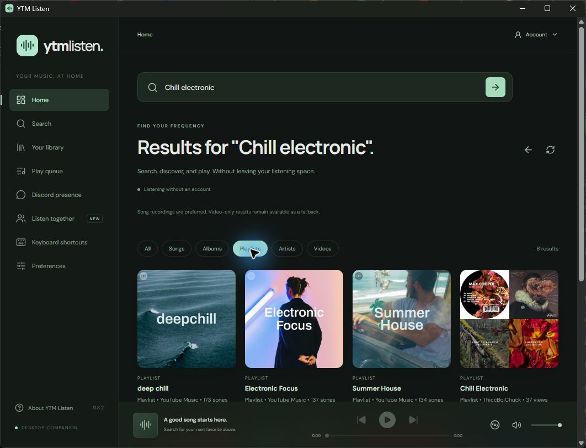
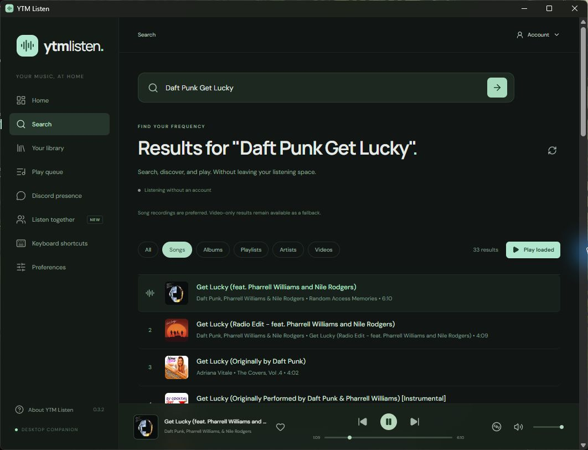
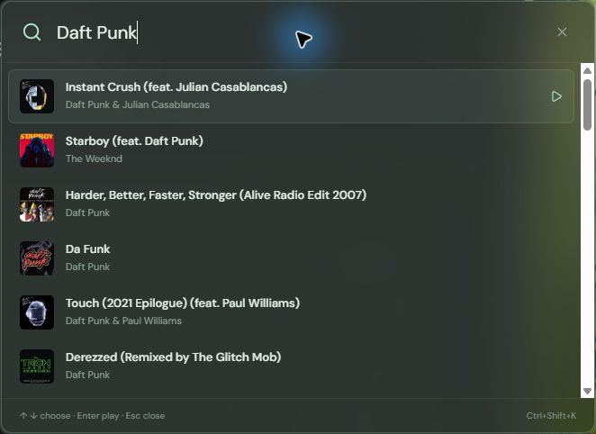
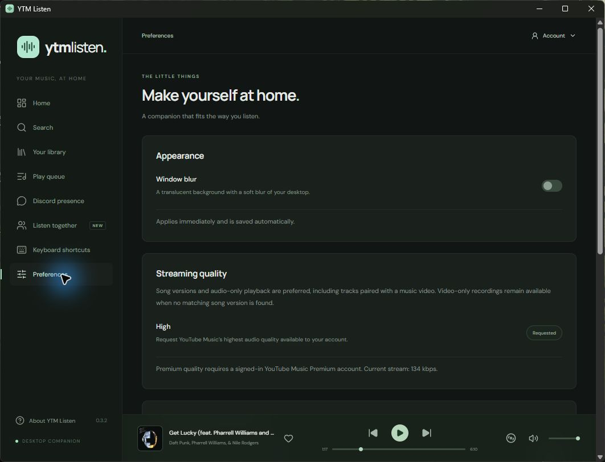

# YTM Listen — YouTube Music Desktop App with Discord Rich Presence

**YTM Listen is a free, open-source YouTube Music desktop client with its own search, library, queue, and player interface.** Listen on Windows, share your current song on Discord, find music from a global keyboard shortcut, and host synchronized listening rooms with friends.

YouTube Music runs in a background playback session. Browsing and playback controls live in the app's own interface, while your Google account and eligible YouTube Music Premium benefits remain part of your YouTube session.

**Version:** 0.3.2 · **Primary platform:** Windows x64 · **License:** [MIT](LICENSE) · **Built with:** Tauri 2, Rust, Svelte 5, and Cloudflare Durable Objects

[Download for Windows](https://github.com/evoziosk/ytm/releases/latest) · [Screenshots](#screenshots) · [Features](#features) · [Build from source](#run-from-source) · [Report an issue](https://github.com/evoziosk/ytm/issues)

[](https://github.com/evoziosk/ytm/actions/workflows/ci.yml)



## Contents

- [Features](#features)
- [Screenshots](#screenshots)
- [Install YTM Listen](#install-ytm-listen)
- [Google sign-in and first launch](#google-sign-in-and-first-launch)
- [Search, playback, and queue](#search-playback-and-queue)
- [YouTube Music Premium audio quality](#youtube-music-premium-audio-quality)
- [Popup search and keyboard shortcuts](#popup-search-and-keyboard-shortcuts)
- [Window blur, tray, and mini-player](#window-blur-tray-and-mini-player)
- [Discord Rich Presence setup](#discord-rich-presence-setup)
- [Listen together with friends](#listen-together-with-friends)
- [Lyrics](#lyrics)
- [Privacy and account data](#privacy-and-account-data)
- [Run from source](#run-from-source)
- [Build installers](#build-installers)
- [Development and testing](#development-and-testing)
- [Architecture](#architecture)
- [Troubleshooting](#troubleshooting)
- [Frequently asked questions](#frequently-asked-questions)
- [Roadmap](#roadmap)
- [Contributing and license](#contributing-and-license)

## Features

| Feature                          | What you can do                                                                                                                                                         |
| -------------------------------- | ----------------------------------------------------------------------------------------------------------------------------------------------------------------------- |
| **YouTube Music desktop player** | Browse Home, search for music, open albums and playlists, access your signed-in library, and control playback inside YTM Listen.                                        |
| **Song-first search**            | Prefer song recordings and audio playback, including eligible tracks paired with a music video. Keep video-only recordings when a matching song version is unavailable. |
| **Premium audio quality**        | Request High through YouTube Music's own player and inspect the active stream's bitrate, quality, and account entitlement in Preferences.                               |
| **Global popup search**          | Press `Ctrl+Shift+K` from another application, search for a song, select with the arrow keys, and press Enter to play.                                                  |
| **Discord Rich Presence**        | Share a Listening activity with song details, artwork, progress, and music or room buttons. Configure pause/idle hiding and artist/playlist blocklists.                 |
| **Listening rooms**              | Host or join a room with track, play/pause, and playback-position synchronization. Share an invitation and transfer the host role.                                      |
| **Queue controls**               | Select, reorder, and remove tracks; clear other tracks; shuffle the remaining queue; and switch repeat off, all, or one.                                                |
| **Desktop integration**          | Use tray controls, configurable global shortcuts, native media controls, an always-on-top mini-player, launch at startup, and close to tray.                            |
| **Optional window blur**         | Enable a translucent main window with native Windows desktop blur. The switch applies immediately and remembers your choice.                                            |
| **Lyrics**                       | Look up plain or synchronized lyrics from LRCLIB, with timed highlighting when available.                                                                               |
| **Windows audio identity**       | See YTM Listen's name and icon in the Windows volume mixer.                                                                                                             |

Windows is the verified development target. macOS and Linux have build configuration in CI, but their native behavior still needs platform testing. Google sign-in and Premium playback have been confirmed working by the user. See the [verification notes](docs/verification.md) for test evidence and remaining manual checks.

## Screenshots

These are captures of the packaged **Windows app, version 0.3.2**, using a separate signed-out profile and public music results. They show the actual desktop interface. Catalog recommendations, artwork, and available recordings can vary by region and account.

### Music search and player

Filter results to Songs, choose a recording, and control playback from the persistent player bar.



### Transparent popup search

Find music in a centered glass overlay with compact results, arrow-key navigation, and Enter to play.



### Appearance and streaming preferences

Control the main window's blur and inspect the stream quality reported by the active player.



## Install YTM Listen

### Windows

1. Download the Windows x64 installer from [GitHub Releases](https://github.com/evoziosk/ytm/releases/latest), or [build an installer locally](#build-installers).
2. When updating, choose **Quit YTM Listen** from the existing app's tray menu first. Closing the window may leave it running in the tray.
3. Run `YTM-Listen_<version>_x64-setup.exe` and follow the installer.
4. Open YTM Listen and search for a song.

The current Windows release is [v0.3.2](https://github.com/evoziosk/ytm/releases/tag/v0.3.2). A SHA-256 checksum is included with the installer. Source builds write packages under `target/release/bundle/nsis/`; generated installers are distributed through Releases rather than committed with the source. Updates currently use manually installed releases.

Windows uses the Microsoft Edge WebView2 runtime for playback. Source builds also require the development tools listed below. See [Tauri's system prerequisites](https://tauri.app/start/prerequisites/) for platform setup.

### macOS and Linux

The release workflow is configured to build macOS DMG and Linux AppImage/DEB packages. Those targets need platform-specific verification before being advertised as supported releases. Native Windows Acrylic blur is Windows-specific.

## Google sign-in and first launch

Public search and playback can be available without signing in, subject to YouTube's availability and regional restrictions. Sign in to use your personal library and account-specific benefits.

1. Open the **Account** menu in the top-right corner.
2. Choose **Sign in with Google**.
3. Complete Google sign-in in the separate account window.
4. When sign-in returns to YouTube Music, the account window closes and the playback connection refreshes.
5. Open **Your library**. If it was already open, refresh its contents.

Once signed in, the top-right menu displays the active account name. Expand it to access **Sign out** and connection controls. The browser profile persists between app launches.

The account window shares the playback session's browser storage. You do not enter a Google password into a custom YTM Listen form, and no separate YTM Listen account is required.

## Search, playback, and queue

### Find music

- **Home** shows recommendations and public catalog collections supplied by YouTube Music.
- **Search** accepts song, artist, and album queries. Use All, Songs, Albums, Playlists, Artists, or Videos when those results are present.
- **Your library** browses music associated with the active YouTube account.
- Open an album, playlist, or artist to browse it, then use **Back** to return.
- Choose **Load more** for another page. Search and collection lists support up to 5,000 loaded items.

Home, Search, and Library retain separate queries, filters, results, and scroll positions while you move around the app. An empty filter offers a way back to the loaded results.

### Prefer music recordings

Search uses YouTube Music's Songs results and compares recording title, artist, and version when matching song/video counterparts. The player prefers Song mode for eligible paired recordings and requests audio-only playback through YouTube Music's own controls.

Live performances, covers, remixes, and other video-only recordings remain available when no matching song recording is found. Account eligibility and the versions supplied by YouTube Music determine the available playback options.

### Control playback

The player bar provides play/pause, previous/next, seeking, volume, mute, and access to the mini-player. Playback commands wait for acknowledgement. If a command fails, the app offers a visible error and retry action.

When seeking, the selected position stays visible while the player confirms it. Raising the volume unmutes playback; muting retains the chosen volume level.

### Manage the queue

Open **Play queue** to select, move, or remove a track. **Clear other tracks** keeps the current song. Shuffle affects the remaining queue, and repeat cycles between **off**, **all**, and **one**.

Choosing a new search result or collection currently replaces the active queue. **Play loaded** queues results already fetched; it does not fetch every remaining catalog page. App-owned session restoration and separate **Play next / Add to queue** actions are planned improvements.

## YouTube Music Premium audio quality

YTM Listen requests **High** audio quality automatically when selecting a song. Eligible Premium playback uses the account entitlement reported by YouTube Music, including its subscriber audio parameter. The app uses the normal YouTube Music playback service.

Open **Preferences → Streaming quality** to inspect:

- Whether High quality was requested.
- Whether a Premium account was detected.
- The quality, codec, and bitrate reported for the active stream, when available.

The displayed bitrate belongs to the format currently playing. A higher-quality format merely being listed as available is not reported as the active stream.

Premium features require the appropriate YouTube Music subscription. Delivered quality also depends on the recording, service availability, connection conditions, and account. See [YouTube Music's audio-quality documentation](https://support.google.com/youtubemusic/answer/9076559).

## Popup search and keyboard shortcuts

### Find and play a song from any app

1. Press **Ctrl+Shift+K**.
2. Type your search.
3. Use **Up** and **Down** to select a result.
4. Press **Enter** to play it.
5. Press **Escape** to dismiss the popup.

The quick-search overlay opens centered in the display work area under your pointer, stays above other applications, focuses its input, and uses a transparent background with Windows desktop blur. It hides after successful selection or when it loses focus.

You can also open it from the tray or **Keyboard shortcuts → Try quick search**. Change its key combination on the Keyboard shortcuts page.

### Default global shortcuts

| Action             | Default shortcut        |
| ------------------ | ----------------------- |
| Play / pause       | `Ctrl+Shift+Space`      |
| Next track         | `Ctrl+Shift+ArrowRight` |
| Previous track     | `Ctrl+Shift+ArrowLeft`  |
| Like current track | `Ctrl+Shift+L`          |
| Toggle mini-player | `Ctrl+Shift+M`          |
| Open popup search  | `Ctrl+Shift+K`          |

Every assignment is configurable. Leave a field empty to disable a shortcut, then save preferences. Another application or development profile may already own a combination; choose another if it does not register. An unavailable existing shortcut does not prevent saving unrelated preferences.

Keyboard media keys use the native system media integration as well.

## Window blur, tray, and mini-player

### Toggle the main window's blur

Open **Preferences → Appearance → Window blur**. The switch applies and saves immediately, preserves other unsaved preference edits, and restores on launch. Turning it off restores the solid background. The default is off.

Changing appearance does not recreate the playback session. Popup search has its own glass appearance independently of the main-window setting.

### Keep music close

- Open the always-on-top **mini-player** from the player bar, tray menu, or shortcut.
- Enable **Keep listening when the window closes** to hide the main window to the tray.
- Use the tray for playback controls, popup search, lyrics, listening rooms, and reopening the app.
- Choose **Quit YTM Listen** in the tray to exit fully.
- Enable launch at startup in Preferences to start the app when you sign in to your computer.

On Windows, audio sessions use YTM Listen's name and icon in the volume mixer. The identity is reapplied when audio sessions or output devices change, without altering mixer volume or mute state.

## Discord Rich Presence setup

Discord integration is optional. It uses the locally running Discord desktop client and a configurable Discord application ID.

1. Create an application in the [Discord Developer Portal](https://discord.com/developers/applications).
2. Copy its **Application ID**.
3. In YTM Listen, open **Discord presence**, enter the ID, and save preferences.
4. Keep the Discord desktop client running and start a song.

Use the public Application ID, **not a bot token, client secret, or account token**. The default ID is empty, so a new installation starts unconfigured.

The activity can include song/artist details, artwork, playback progress, and buttons to open music or a listening room. Updates are coalesced, and the client reconnects when Discord becomes available. Discord controls final rendering and activity/button visibility.

### Presence privacy controls

- **Incognito** hides Discord presence.
- Hide activity while paused or after a configurable idle interval.
- Block selected artists or playlists from appearing in presence.
- Advertisement playback is excluded from the music activity.

Artist blocking currently matches the complete artist field, case-insensitively for ASCII. Playlist blocklists accept identifiers or supported copied links. Native queues retain source-playlist context through paired song/video changes.

Incognito affects Discord only. It does not hide playback from YouTube Music or an active listening room.

## Listen together with friends

Listening rooms synchronize playback commands and timing. Every participant streams independently through their own YouTube Music session. The relay does not carry audio.

### Start or join a room

1. Obtain a relay origin from your relay operator, or [deploy your own](#deploy-a-cloudflare-relay).
2. Open **Listen together** and enter your display name and relay URL.
3. To host, choose **Start a listening room**, then share the invitation or code.
4. To join, enter the code or paste an invitation using the same relay.
5. The host controls playback. Choose **Make host** to transfer that role, or leave the room to resume solo controls.

Invitations use an HTTPS page and a `ytmlisten://join/CODE` app link. Anyone with a room code can attempt to join.

The client supports late joins, reconnects during the running session, member status, and drift correction. Ads and buffering suspend or pause timeline correction as appropriate. A room cannot make subscriptions or regional catalog access identical between accounts.

### Deploy a Cloudflare relay

The relay is a separate Worker using one hibernating Durable Object per room. Building the desktop app does not deploy it.

1. Review [relay/wrangler.toml](relay/wrangler.toml).
2. `RELEASES_URL` points to this project's [releases page](https://github.com/evoziosk/ytm/releases/latest). Change it to your own HTTPS download or releases page if you distribute a fork.
3. Authenticate and deploy using your own Cloudflare account:

```sh
pnpm --filter @ytm/relay exec wrangler login
pnpm --filter @ytm/relay deploy
```

Enter the deployed HTTPS origin, without a room path, in each participant's **Relay URL** field. No relay API key belongs in the desktop client. Loopback HTTP/WS is accepted for local development.

### Room limits and lifetime

| Setting               | Current behavior                                |
| --------------------- | ----------------------------------------------- |
| Participants          | Up to 20 established members per room           |
| Client message size   | Up to 4 KiB                                     |
| Per-connection rate   | Up to 40 messages per 10 seconds                |
| Handshake timeout     | 10 seconds                                      |
| Room expiry           | 10 minutes after the host disconnects           |
| Reconnect credentials | Held in app memory for the current room session |

Restarting the host loses its in-memory reconnect credential; create a new room afterward. The relay stores current room/sync state for hibernation, rather than a listening history. Use a trusted relay operator and deployment-level quotas for a public service; per-room limits do not cap total rooms or hosting costs.

## Lyrics

Open **Lyrics** from Preferences or the tray and look up the current song. Lyrics come from [LRCLIB](https://lrclib.net/docs). Timed lyrics highlight the current line when synchronized text is available; plain lyrics are used when supplied instead.

Lookup sends the track title, artist, and rounded duration to LRCLIB. Availability and version matching depend on its catalog. Automatic lookup and caching are not implemented yet.

## Privacy and account data

| Data or service      | How it is used                                                                                                                            |
| -------------------- | ----------------------------------------------------------------------------------------------------------------------------------------- |
| Google sign-in       | Handled in a persistent WebView account/playback profile. Cookies and authentication headers remain in that website session.              |
| Local preferences    | Stored in Tauri's application data directory. Named profiles separate settings, browser storage, and window geometry.                     |
| Account display name | Shown in the local menu. The catalog bridge returns the active name without the account email.                                            |
| Discord activity     | Sent through local Discord IPC when configured and permitted by presence preferences.                                                     |
| Listening rooms      | Share track identifiers, timing, membership, and display names with the relay/participants. The operator can observe connection metadata. |
| Lyrics               | Send title, artist, and duration to LRCLIB when you request a lookup.                                                                     |

Audio streams through your own YouTube Music session. The app does not download, redistribute, or relay audio, remove ads, or grant Premium access.

The remote page has only two app commands: `player_event` and `catalog_result`. Rust validates origins, values, metadata, and pending catalog request IDs. The page cannot read preferences, receive local state broadcasts, run shell commands, or access arbitrary local files through the app's capability configuration.

Catalog integration uses YouTube Music's undocumented website endpoints inside its session. Website changes can require a bridge update. See [DISCLAIMER.md](DISCLAIMER.md) for service and account considerations.

## Run from source

### Requirements

| Tool or component | Requirement                                                                                |
| ----------------- | ------------------------------------------------------------------------------------------ |
| Node.js           | 22.12 or a supported newer version                                                         |
| pnpm              | 10.32.1, pinned in `package.json`                                                          |
| Rust              | Stable toolchain with Cargo, rustfmt, and Clippy; see `rust-toolchain.toml`                |
| Windows           | Visual Studio Build Tools with **Desktop development with C++**, Windows SDK, and WebView2 |
| macOS / Linux     | Appropriate [Tauri system prerequisites](https://tauri.app/start/prerequisites/)           |

Linux CI installs WebKitGTK 4.1, AppIndicator, librsvg, patchelf, and ALSA development dependencies.

### Launch the desktop app

From the project root:

```sh
pnpm install --frozen-lockfile
pnpm desktop
```

The desktop command builds the bridge, starts Vite, and launches the Tauri client.

### Preview the interface in a browser

```sh
pnpm dev
```

Open `http://127.0.0.1:1420`. This is an interface preview. Music queries, playback, accounts, Discord, and room connections require the desktop app. The preview does not invent a catalog or simulate successful integrations.

## Build installers

```sh
# Build packages for the current platform.
pnpm --filter @ytm/desktop tauri build

# Windows NSIS installer only.
pnpm --filter @ytm/desktop tauri build --bundles nsis
```

This bundles the bridge and interface before compiling Rust. Output is under `target/release/bundle/`, with Windows NSIS packages under `target/release/bundle/nsis/`.

Packages are unsigned unless the maintainer configures signing. The release workflow creates drafts for review; signing, macOS notarization, and signed automatic updates need a maintainer's own configuration. Existing installations update by running a newer installer.

## Development and testing

### Useful commands

| Command               | Purpose                                                    |
| --------------------- | ---------------------------------------------------------- |
| `pnpm desktop`        | Run the native app in development                          |
| `pnpm dev`            | Preview the interface in a browser                         |
| `pnpm build`          | Build the bridge and local interface                       |
| `pnpm check`          | Check TypeScript and Svelte types                          |
| `pnpm lint`           | Check source and documentation formatting                  |
| `pnpm test`           | Run protocol, bridge, interface, and Workers runtime tests |
| `pnpm relay:dev`      | Start the local Cloudflare relay                           |
| `pnpm types:generate` | Generate TypeScript protocol types from Rust               |

For native changes, also run:

```sh
pnpm build
cargo fmt --all --check
cargo clippy --workspace --all-targets -- -D warnings
cargo test --workspace
```

Build the bridge/interface before compiling Rust directly: the app embeds their generated assets. Both lockfiles are included. Protocol changes must regenerate [packages/protocol/src/generated.ts](packages/protocol/src/generated.ts); do not edit it by hand.

### Test two room clients locally

```sh
# Terminal 1: relay
pnpm relay:dev

# Terminal 2: first profile
pnpm --filter @ytm/desktop tauri dev -- --profile host

# Terminal 3: after the native build is ready (Windows)
target\debug\ytm-listen.exe --profile guest
```

On macOS/Linux use `target/debug/ytm-listen`. Set both relay origins to `http://127.0.0.1:8787`.

Named profiles allow multiple clients and isolate browser storage, preferences, and window geometry. The production default profile remains single-instance. Global shortcuts still belong to the OS, so concurrent profiles can compete for keys.

### Verification coverage

Tests cover the protocol, catalog matching/pagination, player acknowledgements, seeking, UI state, queue/privacy behavior, shortcut transactions, synchronization decisions, and the relay in Cloudflare's test runtime.

Native Windows checks exercised real catalog queries, playback, seeking, the global overlay, blur persistence, and mixer metadata. Google sign-in and Premium playback were confirmed by the user. Live Discord rendering, real two-account synchronization, clean-machine installation, and macOS/Linux behavior remain manual acceptance work. Read [docs/verification.md](docs/verification.md) for evidence and limits.

## Architecture

```text
Bundled Svelte interface
        | typed Tauri commands and local state
        v
Rust desktop core
        +-- YouTube Music WebView and injected player/catalog bridge
        +-- Discord IPC and native system media controls
        +-- settings, queue, shortcuts, tray, lyrics, and windows
        +-- optional WebSocket connection to the Cloudflare room relay
```

| Path                      | Responsibility                                                                          |
| ------------------------- | --------------------------------------------------------------------------------------- |
| `apps/desktop/ui/`        | Music interface, player, preferences, mini-player, lyrics, and popup search             |
| `apps/desktop/bridge/`    | Bridge executing inside the YouTube Music session                                       |
| `apps/desktop/src-tauri/` | Rust state, commands, accounts/windows, queue, Discord, media controls, and room client |
| `crates/protocol/`        | Rust wire types and TypeScript exporter                                                 |
| `packages/protocol/`      | Generated TypeScript types                                                              |
| `relay/`                  | Worker, room Durable Objects, invitation page, and runtime tests                        |
| `.github/workflows/`      | Cross-platform checks and draft installer releases                                      |
| `docs/`                   | Screenshots, verification evidence, and feature audit                                   |

The core sends serialized typed calls to the bridge. Catalog replies must match pending random request IDs. Tauri capabilities separate local windows from the remote page, and navigation checks use parsed origins/hosts.

## Troubleshooting

| Problem                                       | What to check                                                                                                                                              |
| --------------------------------------------- | ---------------------------------------------------------------------------------------------------------------------------------------------------------- |
| **Library is empty after sign-in**            | Wait for the connection refresh, then refresh Your library. Check the active account or use Refresh connection in the account controls.                    |
| **Google rejects the account window**         | Record the error and version. Authentication availability is controlled by Google; avoid repeatedly signing in or copying account cookies as a workaround. |
| **Quality shows Normal**                      | Check the active Premium entitlement, whether High was requested, and the available recording. Preferences reports the format actually playing.            |
| **A shortcut does nothing**                   | Check conflicting apps or a second YTM Listen instance. Change or clear the combination in Keyboard shortcuts and save.                                    |
| **Discord is not connected**                  | Enter a public Application ID, enable presence, and run the Discord desktop client. Discord controls final activity visibility.                            |
| **Friends cannot find the room**              | Use the same relay origin and correct code. Confirm the host is connected. A restarted host should create a new room.                                      |
| **Playback controls are locked**              | Room members follow their host. Leave the room to choose your own music.                                                                                   |
| **Music continues after closing**             | Close to tray is enabled. Reopen from the tray or choose Quit YTM Listen.                                                                                  |
| **Windows still shows an Edge mixer entry**   | Update to 0.3.2 or newer, fully quit the old process, open the updated app, and play a song. Audio identity is refreshed periodically.                     |
| **Lyrics are missing or mismatched**          | Retry for the current recording. Lyrics depend on LRCLIB's catalog and track metadata.                                                                     |
| **A package command differs from PowerShell** | Check pnpm is on PATH and the process PATH has no unmatched quote.                                                                                         |

Report the version, OS, steps, and visible error in [GitHub Issues](https://github.com/evoziosk/ytm/issues). Use a separate development profile where possible. Do not include passwords, cookies, authorization headers, or room reconnect credentials.

## Frequently asked questions

### Is this an official YouTube Music app?

No. YTM Listen is an independent open-source desktop client, unaffiliated with Google, YouTube, Discord, or Cloudflare.

### Can I use YTM Listen without YouTube Music Premium?

Public search/playback can work where YouTube permits it. Personal library access needs sign-in, and Premium features require the relevant subscription. The app does not provide Premium access or remove ads itself.

### Does choosing a song open YouTube in my browser?

Browsing and controls stay in YTM Listen. YouTube Music's player runs in a hidden WebView. Google sign-in opens a separate account window.

### Can I download music or listen offline?

Offline downloads are not implemented. Playback needs an internet connection and the normal YouTube Music service.

### Do friends need my account to listen together?

No. Everyone uses their own session. Room messages synchronize the track and timing; they do not share account credentials or carry audio.

### Does Incognito hide my listening-room activity?

No. It hides Discord presence only. YouTube Music and an active room still receive the information needed for their operation.

### Will my queue return after restarting?

The app-owned queue and playback session are not fully restored yet. Google browser storage and preferences persist; queue/session restoration is planned.

### Are automatic updates available?

Updates currently use manually installed releases. A signed updater and its hosting/signing configuration are not included.

## Roadmap

Next priorities focus on everyday listening:

- **Play next / Add to queue** from search, collections, and popup search.
- **Session restoration** for queue, position, shuffle, and repeat.
- **Library and playlist editing**, including save/unsave and adding/removing tracks.
- **Sleep timer** and stop after the current song.
- **Automatic lyrics** lookup, caching, and better version matching.
- **Faster queue editing**, shortcut recording/conflict feedback, and pasted music links.

These are recommendations, not completed features. See the [feature audit](docs/feature-audit.md) for priorities and gaps. Notifications, scrobbling, and signed automatic updates are also deferred.

## Contributing and license

Read [CONTRIBUTING.md](CONTRIBUTING.md) for checks, bridge maintenance, protocol changes, and releases. Keep the remote-page capability boundary small and test account-sensitive work in an isolated profile.

YTM Listen uses the [MIT License](LICENSE). Its app icon is original artwork. Music, catalog artwork, service names, and trademarks remain their owners' property. See [DISCLAIMER.md](DISCLAIMER.md).
