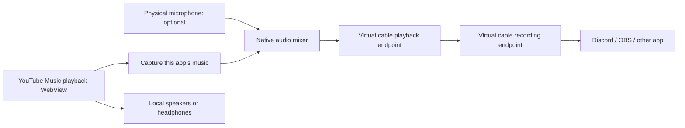

# Virtual microphone integration plan

Status: the first Windows capture, mixer, and UI implementation is present. See the [usage and verification notes](virtual-microphone.md). A separate virtual cable driver is required; driver installation is not bundled. Physical microphone, receiving-app, and long-session hardware acceptance remain pending.

## Intended behavior

YTM Listen can send its music to an audio input selected in Discord, OBS, or another application. The user can optionally add their physical microphone to that same input. Normal music playback continues locally.

The feature starts disabled. Enabling music sharing does not enable the microphone. The physical microphone must be explicitly selected and enabled, with a persistent indicator and an immediate mute control.

## Recommended first version

Target Windows 11 first. Use a separately installed virtual audio cable for the device that other apps see, and implement capture and mixing inside YTM Listen. VB-CABLE is the initial integration candidate: its playback endpoint forwards audio to its recording endpoint. Its recording endpoint retains the vendor's name; calling a setting “Virtual microphone” does not create or rename a Windows device. See the [official product page](https://vb-audio.com/Cable/).

The initial setup should detect compatible devices and link to the vendor's installer if needed. Installation is a separate user action and may require administrator access and a reboot. Bundling the driver can be considered later under the vendor's [distribution terms](https://vb-audio.com/Services/licensing.htm); it is not an assumed dependency of our app installer.

Windows supports capturing a specified process and its descendants without capturing other applications. The API requires Windows build 20348 or newer, so the first implementation should feature-gate unsupported Windows versions rather than change the whole app's requirements. See Microsoft's [application loopback sample](https://learn.microsoft.com/en-us/samples/microsoft/windows-classic-samples/applicationloopbackaudio-sample/).

## Controls

- Share music: off by default, with a visible active indicator and stop action.
- Virtual output: select a render endpoint, initially a detected virtual cable.
- Shared music volume: independent attenuation of the captured music before mixing.
- Include microphone: off by default, separate from music sharing.
- Microphone device, microphone gain, and microphone mute.
- Music, microphone, and combined peak meters, with an overload indicator.
- Clear disconnected-device and unsupported-Windows messages.
- Optional local microphone monitoring, off by default; defer this until the main path works reliably.

Keep the existing player volume behavior until the capture proof establishes where player volume, Windows session volume, and mute affect the captured signal. Do not promise fully independent headphone and outgoing volume before measuring that behavior.

## Audio path and quality

Use the currently decoded playback stream, including the quality available to the signed-in account. Do not add another music download, extractor, or lossy encoding stage.

Proposed internal mix format: 48 kHz stereo, 32-bit floating-point PCM. Negotiate supported endpoint formats, resample explicitly where needed, and duplicate a mono microphone into both channels. This format is a processing choice; it cannot improve the original source quality or guarantee the format received by a voice application.

Use bounded buffers and a dedicated native audio worker. Synchronize the music, microphone, and virtual endpoint clocks with drift correction rather than assuming device clocks remain identical. Avoid allocations, blocking locks, network work, and file access in the real-time audio path. Maintain headroom and use a transparent output limiter to prevent clipping when voice and music overlap.

Start with a measured routing-latency goal below 100 ms on a reference wired setup. Treat it as an acceptance target, not a guarantee; report the chosen buffer size, measured latency, and underruns during testing. Quality takes priority over forcing an unstable buffer size.

Discord or another receiving app can apply its own processing and bitrate limits. Provide a short setup guide and a music test instead of claiming the virtual microphone preserves Premium quality end to end. Discord documents [voice-channel bitrate settings](https://support.discord.com/hc/en-us/articles/11635925354775-Audio-Bitrate-FAQ) and [noise suppression controls](https://support.discord.com/hc/en-us/articles/360040843952-Krisp-FAQ).

## Capture scope and lifecycle

The existing Windows audio identity code already obtains process IDs from the playback WebView2 environment. Extract a reusable process resolver rather than selecting every process named `msedgewebview2.exe`.

Capture only the playback WebView process tree. Do not capture the native mixer process or its virtual-device output: including it can feed the mixed signal back into itself. Confirm which WebView2 process owns audio, track restarts, and avoid overlapping capture trees that duplicate samples. Verify whether any other app-owned WebViews share that audio process before claiming isolation.

Open the physical microphone only after the user enables it. Muting or disabling the mic must clear queued mic samples; disabling microphone inclusion releases its capture client. Selecting a new mic closes the old client before opening the new one. Never choose a different microphone silently after disconnection.

Music sharing may continue when a microphone disconnects, with a visible error. Losing the selected virtual output stops sharing and clears buffers. Device changes, suspend/resume, WebView crashes, and app shutdown must have explicit cleanup and recovery paths. Do not resume microphone capture automatically after an app restart; remember device and gain preferences separately from active sharing state.

Do not change Windows' default input or output devices, and do not choose a physical speaker as a virtual output automatically. Do not automatically enable whole-system loopback when scoped capture fails. Local recordings are not part of the feature; any development capture used for verification must be explicitly started and stopped.

## Implementation sequence

1. **Capture proof.** Confirm app-scoped capture works for actual WebView2 playback and the signed-in Premium account. Measure player-volume and mute behavior, verify silence on pause, track a playback-process restart, and demonstrate that browser audio, notifications, and incoming call audio are excluded. Check whether protected media or a particular renderer produces silence. Stop and revise the design if this gate fails.
2. **Music-only output.** Enumerate endpoints, negotiate formats, route captured PCM to an existing virtual cable, add shared music volume and meters, and verify the resulting input in a recording application. Ensure the native output cannot enter its own capture path.
3. **Optional microphone.** Add explicit device selection, on/off and mute, gain, sample-rate conversion, clock correction, headroom, and limiting. Demonstrate microphone silence when disabled, including already buffered audio.
4. **App controls and recovery.** Add the preferences panel, active-sharing indicator, local-only command permissions, device-loss handling, suspend/resume, and an accessible keyboard flow. Keep microphone capture off after relaunch.
5. **Receiving-app verification.** Verify music-only and mixed audio in Discord and OBS, then perform a long-session drift and dropout test. Write setup instructions with the actual cable endpoint names.
6. **Distribution decision.** Evaluate an optional bundled vendor driver or an app-owned device after the mixer is proven. A branded Windows microphone requires a separate signed-driver project, installer and uninstall lifecycle, and driver-specific testing. Microsoft's [SysVAD sample](https://learn.microsoft.com/en-us/samples/microsoft/windows-driver-samples/sysvad-virtual-audio-device-driver-sample/) is a starting reference, not a ready-made cable. See [driver signing requirements](https://learn.microsoft.com/en-us/windows-hardware/drivers/dashboard/code-signing-reqs).

## Proposed code boundaries

| Area                                                 | Responsibility                                                                                                                 |
| ---------------------------------------------------- | ------------------------------------------------------------------------------------------------------------------------------ |
| `apps/desktop/src-tauri/src/audio/`                  | Windows process capture, device enumeration, real-time buffers, mixer, and virtual-output rendering; platform stubs elsewhere. |
| `apps/desktop/src-tauri/src/media/audio_identity.rs` | Reuse its WebView2 environment scoping through a shared helper; retain current Windows mixer identity behavior.                |
| `apps/desktop/src-tauri/src/settings.rs`             | Persist device IDs and level preferences with safe defaults; keep active sharing and microphone state transient.               |
| `apps/desktop/src-tauri/src/commands.rs`             | Narrow commands for enumeration, start/stop, gains, and mic toggle; do not expose these to the remote YouTube Music origin.    |
| `apps/desktop/src-tauri/capabilities/`               | Allow control only from the bundled local UI that owns the settings panel.                                                     |
| `apps/desktop/ui/`                                   | Audio-sharing panel, meters, status indicator, and actionable errors.                                                          |
| `crates/protocol/` and `packages/protocol/`          | Shared device/status types where needed; no raw audio through the web UI or room relay.                                        |

## Acceptance checks

- Music-only output contains no microphone signal; mic-off and mute clear buffered voice promptly.
- The outgoing mix contains this app's music and the selected microphone only.
- Local playback, seeking, track changes, Premium playback, and quick search continue to work.
- Stereo music and mono microphone conversion are correct; loud overlapping sources do not clip.
- A 44.1 kHz microphone and a 48 kHz cable remain synchronized during a long session.
- Microphone or output removal, default-device changes, WebView restart, sleep, and shutdown do not produce feedback, stale audio, or unexpected microphone selection.
- A reference wired setup meets the measured latency target without sustained underruns.
- The feature's disabled state creates no capture clients and no virtual output stream.
- Windows, macOS, and Linux source builds remain green; audio routing is available only on the supported platform in the first version.

Unit tests should cover mixing, clipping, format conversion, buffer boundaries, clock correction, and state transitions. UI tests should verify device selection and the independent music-sharing and microphone controls. Hardware and driver behavior requires a Windows integration test outside ordinary hosted CI; a successful build alone cannot validate it.

## Later features

Consider optional music ducking while speaking, a push-to-talk shortcut, configurable monitoring, saved routing presets, and platform-specific macOS/Linux backends after the Windows path is stable. None is required for the first usable music-plus-microphone output.
